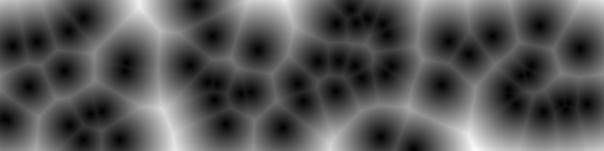
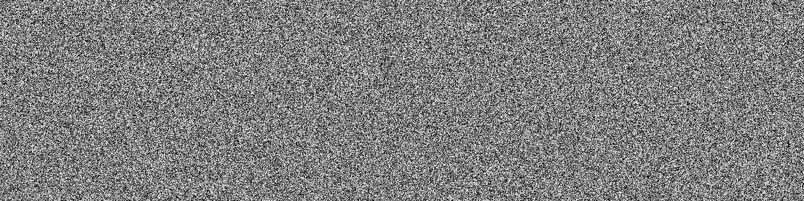
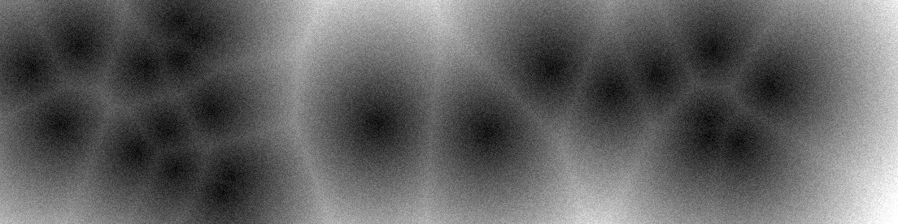
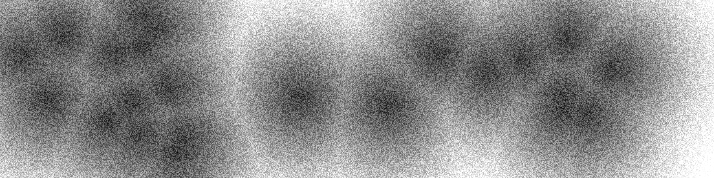
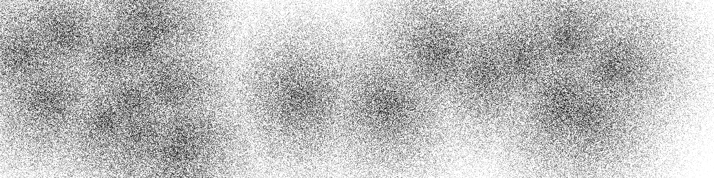
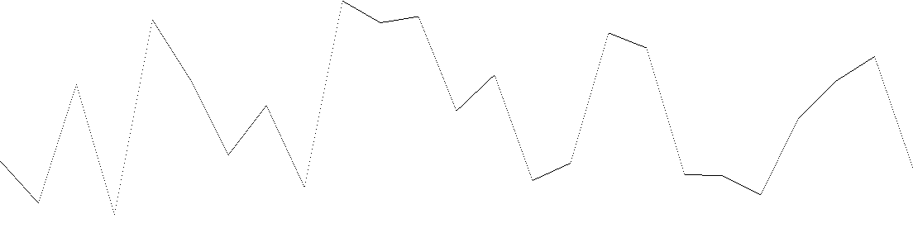
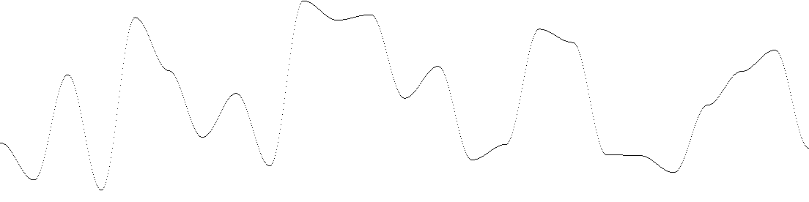
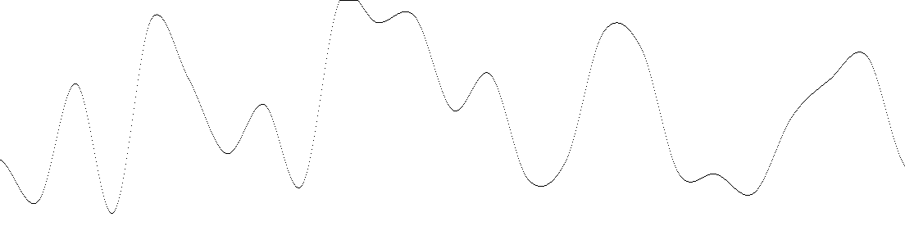
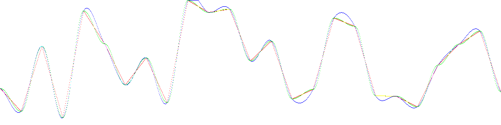

# Procedural Generation — One Algorithm at a Time

Languages: [English](#english-side) · [Français](#french-side)

# English Side

Hey! I'm a dev who loves procedural gen, and I'm currently challenging myself to implement one procedural gen algorithm per day, or at least per week if it's a complicated one.

## Content

- [voronoi-diagrams](#16102026-first-day-voronoi-diagrams)
- [Random](<README#19/10/2026 Day 2 — Random>)
- [Perlin Curves](<README#20/10/2026 Jour 3 — Perlin Curves>)

## 16/10/2026 First day Voronoï diagrams



A Voronoi texture or diagram is a segmentation of a space into cells, where each cell represents the points that are closest to one randomly placed point among all the points placed in that space.

Today, I did the simplest implementation, which can be explained in three simple steps:

1. Place cell points randomly on a grid.
2. Go through each point of the grid and find the distance to the closest cell point.
3. Use the distances you calculated to make a grayscale gradient.

If you want to test it :

```bash
python3 Main.py [Relative Path to your config file]
```

Use [This One](./Data/Voronoi.json) as an example

[Voronoi Diagram — Wikipedia](https://en.wikipedia.org/wiki/Voronoi_diagram)

## 19/10/2026 Day 2 — Random

Even today, a simple algorithm generates random noise. Although it isn't particularly useful on its own, it can be used to add texture to other algorithms.

Its implementation is simple: we fill our grid with random numbers in our case, a number between 0 and 1. This allows us to create noise textures like this.



And as I mentioned earlier, it is possible to use this noise texture to introduce variation into our textures. The following examples use the same random seed and vary only the degree of variation that the randomization applies to the Voronoi texture, ranging from 0 to 1.








If you want to test it :

Command to execute it from this folder

```bash
python3 Main.py [Relative Path to your config file]
```

Use [This One](./Data/Random.json) as an example

## 20/10/2026 Day 3 — Perlin Curves

So far, we have seen two families of algorithms: those that produce completely random results and those that produce controlled or ordered randomness.

Today, we're revisiting ordered randomness with Perlin noise. Perlin noise is an algorithm widely used in procedural generation. It produces values that vary gradually relative to their neighbors.

For now, we'll simply implement it in one dimension to better understand how it works. This will allow us to generate a curve.

### 1. Generating the Points

First, we'll define a scale, that is, the number of points our curve will contain.

For each of these points, we'll generate a random number between -1 and 1. This value represents the y-coordinate at the beginning of each section of our curve.

Next, we'll calculate all the intermediate points within each section.

We can think of each section as a line segment connecting two points:

- **A**: the point at the beginning of the section;
- **B**: the next point.

The last point serves only as the endpoint for the final section.

### 2. Custom Linear Interpolation

If we consider only a single section, we can place point A at the origin of our local coordinate system and point B at x-coordinate 1.

We therefore have:

Nous obtenons donc :

- `A(0, Y_a)`
- `B(1, Y_b)`

We want to find an intermediate point `P(x, Y_p)` located on segment AB. The value of x represents the proportion of the distance traveled from A to B. It is therefore between 0 and 1.

Since we know `x`, we can use vector calculations to find the y-coordinate of point P.

The difference `Yb - Ya` represents the vertical displacement between A and B. Since our starting point is `A`, we obtain the following formula:

```math
Yp = Ya + (Yb - Ya) * x
```

This gives us the following result:


### 3. Linear Interpolation

Another way to obtain the same result is to use a linear **interpolation formula**:

```math
Yp = (1.0 - x) * Ya + x * Yb
```

This formula produces exactly the same result as the previous one.



However, linear interpolation produces a curve made up of segments with sharp corners at their junctions. This result is less aesthetically pleasing and less suitable for some procedural generation applications where smoother transitions are desirable.

### 4. Cosine Interpolation

To address this issue, we can use cosine interpolation. It modifies the progression between the two endpoints to create a smoother transition.

First, we calculate an interpolation coefficient c:

```math
c = (1 - cos(x * 3.1415927)) * 0.5
Yp = (1.0 - c) * Ya + c * Yb
```

This gives us the following result:



The result is smoother. However, the junctions between sections are not yet perfectly smooth because we only take the endpoints of each section into account, without considering the points before and after it.

To improve the result, we'll use cubic interpolation.

### 5. Cubic Interpolation

Consider a section defined by points B and C. The previous section is defined by A and B, while the next section is defined by C and D.

We therefore have four points:

- **A**: the point preceding the section;
- **B**: the beginning of the section;
- **C**: the end of the section;
- **D**: the point following the section.

These four points allow us to calculate the coefficients of a cubic polynomial:

```cpp
c0 = b;
c1 = -0.5 * a + 0.5 * c;
c2 = a - 2.5 * b + 2.0 * c - 0.5 * d;
c3 = -0.5 * a + 1.5 * b - 1.5 * c + 0.5 * d;
```

We can then use these coefficients to calculate the y-coordinate of each intermediate point:

```math
Y = (c3 * x³) + (c2 * x²) + (c1 * x) + c0
```

This method, known as **Catmull-Rom cubic interpolation** in this formulation, takes neighboring points into account to produce a smoother curve.

This gives us the following result:



We obtain a nice curve without sharp corners, although some portions may extend slightly beyond the values of our control points.

### 6. Comparaison des interpolations

If we assign a color to each method, in the order red, green, and blue, we obtain:



This comparison helps visualize the differences between the interpolation methods and their influence on the shape of the curve.

### 7. Exécution du code

To test the code, run the following command from this directory:

```bash
python3 Main.py [Relative path from this directory]
```

#### Fichiers d'exemple

Four example files are available:

- [Custom Linear Interpolation](./Data/PerlinCurvePerso.json)
- [Linear Interpolation](./Data/PerlinCurveLinear.json)
- [Cosine Interpolation](./Data/PerlinCurveSine.json)
- [Cubic Interpolation](./Data/PerlinCurveCubic.json)

## 8. Pour aller plus loin

If you'd like to learn more about Perlin noise and discover a few concepts that will be useful for upcoming algorithms, you can check out this article (it's in french though):

- [Développez.com — Introduction au bruit de Perlin](https://cochoy-jeremy.developpez.com/tutoriels/2d/introduction-bruit-perlin/)

This is the article I used as the basis for my implementation.

# French Side

[Retour à la version anglaise](#english-side)

Salut ! Je suis développeur et j'adore la génération procédurale. Je me suis lancé un défi : implémenter un algorithme de génération procédurale par jour, ou au moins par semaine si l'algorithme est compliqué.

## Sommaire

- [Diagrammes de Voronoï](#16102026-premier-jour--diagrammes-de-voronoï)
- [Random](<README#19/10/2026 Jour 2 — Random>)
- [Courbes de perlin](<README#20/10/2026 Jour 3 — Courbes de Perlin>)

## 16/10/2026 Premier jour — Diagrammes de Voronoï

Une texture ou un diagramme de Voronoï est un découpage de l'espace en cellules, où chaque cellule représente les points les plus proches d'un point placé aléatoirement parmi tous les points disposés dans cet espace.

Aujourd'hui, j'ai réalisé l'implémentation la plus simple, qui peut s'expliquer en trois étapes :

1. Placer des points de cellule aléatoirement sur une grille.
2. Parcourir chaque point de la grille et trouver la distance jusqu'au point de cellule le plus proche.
3. Utiliser les distances calculées pour créer un dégradé en niveaux de gris.

Le code, si vous voulez le tester : [Code de test](TestCodes/MiniVoronoi.py)

Si vous voullez faire des test du code.

Commande pour l'executer depuis ce dossier:

```bash
python3 Main.py [Chemin relatif depuis ce dossier]
```

Utiliser [celui ci](./Data/Voronoi.json) comme example

Plus d'info ici
[Diagramme de Voronoï — Wikipédia](https://fr.wikipedia.org/wiki/Diagramme_de_Vorono%C3%AF)

## 19/10/2026 Jour 2 — Bruit

Aujourd'hui encore, un algorithme simple le bruit aléatoire. Bien qu'il ne soit pas vraiment utile par lui-même, il peut être utilisé pour ajouter de la texture à d'autres algorythmes.

Son implémentation est simple : on remplit notre grille de nombres aléatoires, un chiffre entre 0 et 1 dans notre cas. Ce qui nous permet de créer des textures de bruit comme ceci.


Et comme je l'ai mentionné précédemment, il est possible d'utiliser cette texture de bruit pour apporter de la variance dans nos textures. Les exemples suivants utilisent la même graine d'aléatoire et varient seulement le degré de variance que l'aléatoire applique sur la texture de Voronoi, allant de 0 à 1.


Si vous voullez faire des test du code.

Commande pour l'executer depuis ce dossier:

```bash
python3 Main.py [Chemin relatif depuis ce dossier]
```

Utiliser [celui ci](./Data/Random.json) comme example ou ceux ci pour les différentes variances:

- [Variance 0.15](./Data/VoronoiVariance015.json)
- [Variance 0.5](./Data/VoronoiVariance05.json)
- [Variance 1](./Data/VoronoiVariance1.json)

## 20/10/2026 Jour 3 — Courbes de Perlin

Jusqu'à présent, nous avons vu deux familles d'algorithmes : ceux qui produisent un résultat complètement aléatoire et ceux qui produisent un aléatoire contrôlé ou ordonné.

Aujourd'hui, nous revenons sur l'aléatoire ordonné avec le bruit de Perlin. Le bruit de Perlin est un algorithme très utilisé dans la génération procédurale. Il produit des valeurs qui varient graduellement par rapport à leurs voisines.

Pour l'instant, nous allons simplement l'implémenter en une dimension afin de mieux comprendre son fonctionnement. Cela nous permettra de générer une courbe.

### 1. Génération des points

Tout d'abord, nous allons définir une échelle, c'est-à-dire le nombre de points que notre courbe comportera.

Pour chacun de ces points, nous allons générer un nombre aléatoire compris entre -1 et 1. Cette valeur représente l'ordonnée (Y) au début de chaque section de notre courbe.

Ensuite, nous allons calculer tous les points intermédiaires de chaque section.

Nous pouvons considérer chaque section comme un segment reliant deux points :

- **A** : le point au début de la section ;
- **B** : le point suivant.

Le dernier point sert uniquement de borne de fin pour la dernière section.

### 2. Interpolation linéaire personnalisée

Si nous considérons uniquement une section, nous pouvons placer le point A à l'origine de notre repère local et le point B à l'abscisse 1.

Nous obtenons donc :

- `A(0, Y_a)`
- `B(1, Y_b)`

Nous cherchons un point intermédiaire `P(x, Y_p)` situé sur le segment AB. La valeur de `x` représente la proportion du chemin parcouru entre A et B. Elle est donc comprise entre 0 et 1.

Puisque nous connaissons `x`, nous pouvons utiliser un calcul vectoriel pour trouver l'ordonnée du point P.

La différence `Yb - Ya` correspond à la variation verticale entre A et B. Comme notre point de départ est A, nous obtenons la formule suivante :

```math
Yp = Ya + (Yb - Ya) * x
```

Ce qui nous donne ceci :


### 3. Interpolation linéaire

Une autre manière d'obtenir le même résultat consiste à utiliser une formule d'**interpolation linéaire** :

```math
Yp = (1.0 - x) * Ya + x * Yb
```

Cette formule donne exactement le même résultat que la précédente.


Cependant, l'interpolation linéaire produit une courbe composée de segments dont les jonctions sont anguleuses. Ce résultat est moins esthétique et moins adapté à certains usages de la génération procédurale lorsqu'une transition plus douce est souhaitée.

### 4. Interpolation cosinusoïdale

Pour remédier à ce problème, nous pouvons utiliser une **interpolation cosinusoïdale**. Elle modifie la progression entre les deux extrémités afin de rendre la transition plus douce.

Nous calculons d'abord un coefficient d'interpolation `c` :

```math
c = (1 - cos(x * 3.1415927)) * 0.5
Yp = (1.0 - c) * Ya + c * Yb
```

Ce qui nous donne ceci :


Le résultat est plus doux. Cependant, les jonctions entre les sections ne sont pas encore parfaitement lisses, car nous ne prenons en compte que les extrémités de la section, sans considérer les points qui la précèdent et la suivent.

Pour améliorer le résultat, nous allons utiliser une interpolation cubique.

### 5. Interpolation cubique

Considérons une section définie par les points B et C. La section précédente est définie par A et B, tandis que la suivante est définie par C et D.

Nous disposons donc de quatre points :

- **A** : le point précédant la section ;
- **B** : le début de la section ;
- **C** : la fin de la section ;
- **D** : le point suivant la section.

Ces quatre points nous permettent de calculer les coefficients d'un polynôme cubique :

```cpp
c0 = b;
c1 = -0.5 * a + 0.5 * c;
c2 = a - 2.5 * b + 2.0 * c - 0.5 * d;
c3 = -0.5 * a + 1.5 * b - 1.5 * c + 0.5 * d;
```

Nous pouvons ensuite utiliser ces coefficients pour calculer l'ordonnée de chaque point intermédiaire :

```math
Y = (c3 * x³) + (c2 * x²) + (c1 * x) + c0
```

Cette méthode, appelée **interpolation cubique de Catmull-Rom** dans cette formulation, prend en compte les points voisins pour obtenir une courbe plus fluide.

Ce qui nous donne ceci :


Nous obtenons une belle courbe sans angles marqués, même si certaines portions peuvent dépasser légèrement les valeurs de nos points de contrôle.

### 6. Comparaison des interpolations

Si nous attribuons une couleur à chaque méthode, dans l'ordre rouge, vert et bleu, nous obtenons :


Cette comparaison permet de visualiser les différences entre les méthodes d'interpolation et leur influence sur la forme de la courbe.

### 7. Exécution du code

Pour tester le code, utilisez la commande suivante depuis ce dossier :

```bash
python3 Main.py [Chemin relatif depuis ce dossier]
```

#### Fichiers d'exemple

Quatre fichiers d'exemple sont disponibles :

- [Interpolation linéaire personnalisée](./Data/PerlinCurvePerso.json)
- [Interpolation linéaire](./Data/PerlinCurveLinear.json)
- [Interpolation cosinusoïdale](./Data/PerlinCurveSine.json)
- [Interpolation cubique](./Data/PerlinCurveCubic.json)

### 8. Pour aller plus loin

Si vous souhaitez obtenir davantage d'informations sur le bruit de Perlin et découvrir quelques notions qui seront utiles pour les prochains algorithmes, vous pouvez consulter cet article :

- [Développez.com — Introduction au bruit de Perlin](https://cochoy-jeremy.developpez.com/tutoriels/2d/introduction-bruit-perlin/)

C'est cet article qui m'a servi de base pour mon implémentation.
